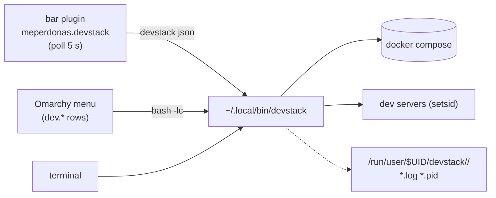

# devstack — local dev stacks for the Omarchy bar

[](https://github.com/meperdev/omarchy-devstack/actions/workflows/ci.yml)

One bar icon in the Omarchy bar (plus a menu section and a CLI) to lift, watch and
drop the local stack of a project: docker services, dev servers, health checks
and the browser, in order.

It ships as an **Omarchy plugin** (`bar-widget`), so it installs with
`omarchy plugin add`, updates with `omarchy plugin update` and is configured from
the Omarchy settings UI. Nothing is hardcoded to one project: you declare each
stack in a JSON file.


While an action runs the icon breathes and the panel shows the dots plus a slow
progress line, so you can see it is working instead of guessing:


The icon is grey when the stack is off, red on error, yellow while lifting and
green when every service answers.

## What it does

- **`up`** walks your services in order: `docker compose up -d` → wait for the
  port → start the dev server → wait for its health URL. Then it opens the
  browser **only if the frontend already answers**, so you never get a tab
  spinning while the bundler compiles the first route.
- **`down`** kills each process **group** (no orphan `nest`/`next` left) and
  brings docker down last. Data volumes are kept.
- **It never touches what it did not start.** A dev server you launched by hand
  is reported as `ajeno`/`ext` and left alone. When you want it out of the way,
  `--force` (or the contextual *Tomar el control* button) kills that PID — with a
  guard so it never kills its own process group.
- **Per-stage notifications** (`Compilando el backend…`, `Backend respondiendo
  (:3001)`, `Stack arriba en 42s`): you always know when it finished, and errors
  notify too.
- **Four-colour state** everywhere: the bar icon, the status chip and one chip
  per service.

| State | Colour | When |
|---|---|---|
| off | grey `#7A8394` | nothing is up |
| error | red `#E05561` | the probe failed, or a service listens and does not answer |
| working | yellow `#E5B454` | lifting / restarting / partially up / compiling the first route |
| ok | green `#7FBF7F` | every service with a health URL responds |

## Where this sits next to the neighbours

The marketplace already has plenty of plugins that *watch* docker or *find*
ports. This one is about **lifting a project's stack in order** — and that is a
different job:

| If you want to… | A plugin like… may be enough |
|---|---|
| see container state, logs, stats | the docker monitor plugins |
| find, open or kill a port that is already listening | the port-discovery plugins (Localhost, Omaports, Portboard, aportless) |
| toggle individual services/commands by hand | Services Manager |
| **declare one project, start its services in order, wait for real health, open the browser when it answers, and stop the whole thing without orphans** | devstack |

devstack also takes over a port that a stray dev server is holding (`--force`),
and never touches a process it did not start.

## Requirements

- Omarchy with plugin support (the bar widget is a `bar-widget` plugin). The CLI
  alone also runs on plain Arch/Hyprland: bash, `jq`, `curl`, `ss` (iproute2).
- `docker` only if you declare docker services.
- For docker without the `docker` group: `polkit` (the Omarchy dialog asks for
  the password) and/or `sudo`.

## Install

One command: the plugin carries the CLI and the example stacks inside the same
clone, so the widget works as soon as it is enabled.

```bash
omarchy plugin add https://github.com/meperdev/omarchy-devstack --enable
devstack init my-app        # creates ~/.config/devstack/my-app.json from the example
devstack my-app up          # once you edited dir + services
```

Already included, no extra steps: the widget's menu button, the shipped `demo`
stack (`devstack demo up`, a python http.server) and `example`.

Optional extras:

```bash
git clone https://github.com/meperdev/omarchy-devstack.git && cd omarchy-devstack
./install.sh --menu          # adds the Dev section to the Omarchy menu
./install.sh --project my-app   # points the widget at one project
```

`install.sh` is idempotent, updates the plugin when it is already installed, never
overwrites an existing config, and leaves a backup of every file it edits. Flags:
`--project NAME`, `--config FILE` (repeatable), `--menu`,
`--section left|center|right`, `--no-enable`, `--dry-run`.

Everything else is one `install` away if you want the CLI on `PATH`:

```bash
install -m755 ~/.config/omarchy/plugins/meperdonas.devstack/bin/devstack ~/.local/bin/devstack
```

Uninstall with `./uninstall.sh` (add `--keep-config` to keep your stacks).

## Try it in one minute (no docker, no node)

```bash
DEVDATA_CONFIG="$PWD/config" DEVDATA_PROJECT=demo bin/devstack demo up
```

`config/demo.json` is a single `python3 -m http.server` on `:8080`.

## Point it at any repo

You do not have to write the JSON by hand: the CLI works the stack out and
**proposes** it (read-only — it never executes the project, never elevates, and
never copies `.env` secrets, only ports and local URLs).

```bash
devstack scan ~/Projects/my-app     # proposal + the evidence for every guess
devstack add  ~/Projects/my-app     # writes ~/.config/devstack/my-app.json
```

| Signal | What it infers |
|---|---|
| compose files | one docker service per file: engine, container name, published port |
| `package.json` | Node: Next, Nuxt, SvelteKit, Astro, Vite, CRA, Nest, Express/Fastify/Hono — with the framework's own dev command and port |
| other manifests | Python (FastAPI/uvicorn, Django, Flask), Go, Rust (incl. `trunk`), PHP/Laravel, Ruby/Rails |
| `.env` | its own `PORT`/`APP_URL`, and the backend port the frontend points at (`NEXT_PUBLIC_API_URL`) |
| source | Nest's `setGlobalPrefix('api')` → `/api/health`; Prisma → seed/migrate/studio tasks |
| `AGENTS.md`, `CLAUDE.md`, `README.md`, `.claude/`, `.codex/`, `.opencode/`, `.pi/`, `herdr*` | the commands the repo already documents — the most reliable source in repos that are worked on inside a coding agent |

`scan` prints the reasoning line by line; `add` refuses to overwrite an existing
project, refuses to declare the same directory twice under another name, and is
*idempotent*: running it again on the same directory is not a conflict, it just tells you
it was already declared (`--force` overwrites, `--name <otro>` declares the same directory
under another name).
project and refuses to declare the same directory twice under another name.

### Follow the session (auto mode)

The widget can show the stack of **the terminal you are looking at** instead of a
fixed project:

```bash
devstack here json --window   # what the widget calls every 5 s
devstack here json --window --fallback myapp   # …and answer with myapp if nothing resolves
devstack here status          # the project of the terminal you are in
devstack here up              # lift the stack of the project you are standing in
devstack here down            # …and drop it
```

`here` reads the working directory of the focused window (walking the process tree of
the active window, so it works with any terminal — Omarchy's helper only knows kitty —
and then asking `omarchy-cmd-terminal-cwd`), maps it to the declared project that contains it —
longest match wins, so a subdirectory is still its project — and forwards any
subcommand there. An undeclared repo shows up in the widget as
`Sin declarar · <repo>` with a **Declarar este stack** button that runs the
detector in a terminal, so you see what it inferred before anything is written.
If nothing resolves (you are looking at the browser, not a terminal)
`--fallback <project>` answers with that project *in the same call* — the widget
passes its `project` setting that way, so one probe resolves everything and the
state never blinks; `mode: fixed` pins one project like before.

Path resolution only looks at *your* projects (`~/.config/devstack`): the examples
that ship with the plugin are for trying things out, not for deciding where you are.

### When the detection gets it wrong (or you just want to decide)

Resolution is a short chain and every step is a manual override:

1. **the terminal you are looking at** — `mode: auto`, `devstack here json --window`;
2. **the `project` setting** of the widget, which travels as `--fallback <project>`;
3. **the project of the house** — `devstack use <project>`. That is just the file
   `~/.config/devstack/default`, which plain `devstack json` also reads when you
   have several projects and pass no name;
4. nothing — the widget says *Sin proyecto · elegí uno abajo* and lists your projects
   so you can pick one.

You never have to leave the bar: **click a row** in the popup to pin that project (the
widget stops following the terminal) and **Quitar el fijado** to go back. Pressing a
button no longer closes the popup (you watch the lift happen; `closeAfterAction: true`
in the widget entry brings the old behaviour back), and a row whose own ▶/⏻ button
started something shows *levantando…* exactly like the big button does. While the
finder is open the popup shows only the finder — no service chips and no project
buttons competing for the screen. The pin is
stored with `devstack use`, so it survives a shell restart and the CLI agrees with
what the bar shows:

```bash
devstack use            # which project is the house project
devstack use meperpos   # make it this one
devstack use --clear    # forget it: back to the focused terminal
```

And when you would rather go looking yourself, the popup has a **Buscar proyectos**
button: it runs `devstack find`, which walks your project folders (`~/Projects` by
default; `DEVDATA_SEARCH_ROOTS` with `:` for more, `--depth` for deeper trees) and
lists every repo with a stack it can recognise — the ones you already declared first,
with their live state. Candidates are labelled with the folder name when it is not repeated, and with their
path inside the search root when it is (`backend` from two different repos still tells
them apart; `Proyecto de Grado/gestion-inventario-app` shows up as
`gestion-inventario-app`)
(`MeperPOS-loans-module`, `Proyecto de Grado/gestion-inventario-app`), so two `backend`
folders never look the same; a directory whose stack is already covered by its parent
is not offered again. Clicking a declared one lifts it (and pins it); clicking one
that is not declared yet declares it *and* lifts it in a terminal, so you see what
the detector inferred before anything is written.

```bash
devstack find                      # repos with a stack in ~/Projects (writes nothing)
devstack find --json               # the same, machine-readable (what the widget reads)
devstack find ~/code ~/work --depth 3
```

The popup is 340 px wide by default and the buttons fill it; if you want it wider for
longer names, add `"popupWidth": 380` to the widget entry (the content area is that
minus the 32 px of margins).

For something permanent, use `mode: fixed` plus `project` in the widget entry, or
point the whole widget at any CLI invocation with the `command` setting
(`command: "DEVDATA_CONFIG=/tmp/lab devstack"`).

### Every project at a glance

```bash
devstack all status     # one line per project: up/total plus a per-service state
devstack all json       # the same, machine-readable (what mode: all reads)
devstack all up         # lift what is missing, project by project
devstack all down       # stop everything
```

`mode: all` in the widget turns the icon into an aggregate — the glyph plus `N/M`
— and the popup into one row per project with **Levantar lo que falta** and
**Bajar todo**. Only projects *you* declared count; the examples shipped with the
plugin stay out.

In `auto` and `fixed` the same rows appear at the top of the popup as a **project
selector**: the one being shown is in bold, a click on a row pins that project
(the widget stops following the terminal; **Quitar el fijado** goes back), and the
row's `▶`/`⏻` button lifts or drops just that project.

Two of your projects declaring the same port is warned about in `devstack all status`,
and the widget shows it under the service chips (`:3000 compartido con otro proyecto`)
— the one listening may be the other project's process, so a stack can look "up" when
what answers is its neighbour. The chips carry their port and mark `·ajeno` when the
process answering is not devstack's, and a project row goes amber in that case instead
of green.

The way out is a port that devstack hands to the service, so two stacks can coexist:

```bash
devstack meperpos port web --auto     # pick a free port, write port/url/health/cmd
devstack meperpos port web --to 3050  # or a specific one
devstack meperpos port web --dry-run  # show what it would change
```

`--auto` skips ports declared by your other projects and ports in use, and `port`
rewrites three things so the app actually listens where devstack looks: the `port`
itself, `url`/`health` if they carried the old one, and the `cmd` — `npm run dev`
becomes `npm run dev -- --port {port}`, which both Vite and Next understand. Devstack
also exports `PORT` (and `DEVDATA_PORT`) to every process service, so a `{port}` in
your command or a framework that reads `PORT` just works. For a docker service the
host port comes from its compose, so `port` refuses and says so. The popup shows a
**Mover el puerto :3000** button whenever there is a clash.

If a service dies because its dependencies are missing (`next: command not found`,
`vite: command not found`), devstack now says so (`[aviso] Parece que faltan
dependencias en … probá 'npm install'`) instead of leaving you with just the log.

Every `up`/`down`/`restart` leaves its outcome in the project's runtime dir, exposed
as `lastResult` in `devstack <p> json`, so the widget stops saying *Levantando…* as
soon as the CLI finishes — and says *Falló: …* when it failed. `Bajar` stays clickable
while starting (that is the way out of a stuck lift), and a service that answers
nothing is flagged in the state.

A service that is listening but never answers the health check is reported as
`Servicio sin responder` and the "lifting" state is dropped there: without that,
an action that can never finish would keep the 2-second polling and the progress
sweep running for the whole timeout.

### Let your coding agents drive the stacks (MCP)

`bin/devstack-mcp` is an MCP server over stdio (bash + jq, no dependencies)
exposing `devstack_list`, `devstack_status`, `devstack_here`, `devstack_scan`,
`devstack_declare`, `devstack_up`, `devstack_down` and `devstack_logs`: an agent
can see your stacks, start what is missing, diagnose a failure from the logs and
stop things again, with the same guarantees as the CLI (nothing it did not start
gets touched). `devstack_up` starts detached and returns immediately — the agent
follows with `devstack_status`.

```jsonc
// Claude Code — or: claude mcp add devstack -- /home/USER/.local/bin/devstack-mcp
// ~/.claude.json (or a project .mcp.json)
{ "mcpServers": { "devstack": { "type": "stdio", "command": "/home/USER/.local/bin/devstack-mcp" } } }

// opencode — ~/.config/opencode/opencode.json, next to your other MCP entries
{ "mcp": { "devstack": { "type": "local", "command": ["/home/USER/.local/bin/devstack-mcp"], "enabled": true } } }

// codex — ~/.codex/config.toml
[mcp_servers.devstack]
command = "/home/USER/.local/bin/devstack-mcp"
```

Any client that speaks MCP over stdio works the same way: the command is
`devstack-mcp` (omp, pi, herdr, … included).

## Configure a stack

`~/.config/devstack/<name>.json`:

```json
{
  "name": "MeperPOS",
  "dir": "~/Projects/MeperPOS",
  "services": [
    { "id": "db", "label": "postgres", "type": "docker",
      "compose": "backend/docker-compose.yml", "container": "postgres-db",
      "port": 5432, "wait": 60 },

    { "id": "api", "label": "backend", "dir": "backend", "cmd": "npm run start:dev",
      "port": 3001, "health": "http://localhost:3001/api/health", "wait": 180 },

    { "id": "web", "label": "frontend", "dir": "frontend", "cmd": "npm run dev",
      "port": 3000, "health": "http://localhost:3000", "wait": 120, "open": true }
  ],
  "tasks": [
    { "id": "seed", "label": "Seed data", "dir": "backend",
      "cmd": "npm run seed", "needs": ["db"] }
  ]
}
```

| Field | Meaning |
|---|---|
| `id` | short id used by the CLI and the bar (`devstack myproject restart api`) |
| `label` | what you see in the chips and in `status` |
| `type` | `process` (default) or `docker` |
| `dir` | service working dir, relative to `dir` |
| `cmd` | command to run (`process`) — launched with `setsid`, logged to a pidfile |
| `compose` / `container` | compose file and container name (`docker`) |
| `port` | port that must open before the next service starts |
| `health` | URL polled until it answers 2xx; also drives the green state |
| `url` | URL to open with `devstack <p> open` (falls back to `health`) |
| `wait` | seconds to wait for port/health (scaled by `DEVDATA_WAIT_SCALE`) |
| `open` | `true` on the service the browser button should open |
| `tasks[].needs` | services to lift before running the task |

## CLI

```bash
devstack                          # list configured projects
devstack <p> up [--force]         # lift everything (--force takes foreign ports)
devstack <p> down [--keep-docker] [--force]
devstack <p> restart [id ...] [--force]
devstack <p> status               # per-service state, owner PID, URLs
devstack <p> json                 # machine-readable state (what the bar reads)
devstack <p> logs [id]            # follow logs
devstack <p> open [id]
devstack <p> task <id>            # seed, migrate, studio, …
devstack <p> up <id ...>          # lift only some services
devstack <p> list                 # declared services and tasks
devstack <p> menu                 # print the JSONC block for the Omarchy menu
devstack <p> --running | --up | --foreign   # guards for the menu
```

`DEVDATA_CONFIG` (config dir), `DEVDATA_PROJECT` (default project),
`DEVDATA_WAIT_SCALE` (multiply waits) and `DEVDATA_NOTIFY` (`all` | `final` |
`off`) override the defaults.

### Notifications

The panel already shows the progress (state chip, one chip per service, the
working animation), so notifications only carry the **outcome** when an action
comes from the bar: `Stack arriba en 42s`, `Stack parcial…`, or the error. That
is what keeps the popup from covering a pile of its own "compiling…" notices —
Omarchy anchors notifications next to the bar, exactly where the widget lives.

- `final` (default in the widget): only the outcome.
- `all`: every stage (useful from the menu or a terminal, where there is no panel).
- `off`: silence.

Set it per widget instance in the Omarchy settings UI (`notifyMode`) or with
`DEVDATA_NOTIFY` on any CLI call.

## Several projects on the bar

`allowMultiple` is on, so you can run one widget instance per project. Add the
widget again from the Omarchy settings UI (or `omarchy plugin enable
meperdonas.devstack --section right`) and give each instance its `project` in
`~/.config/omarchy/shell.json`:

```json
{ "id": "meperdonas.devstack", "project": "meperpos" },
{ "id": "meperdonas.devstack", "project": "other-app" }
```

The widget also reads the project the CLI resolved, so a single instance with no
`project` set follows whichever project is the default.

## How it is wired



## Caveats

- Services live **inside your user session** (`/run/user/$UID/devstack/`): a
  reboot or a session logout takes them down. That is intentional — nothing
  survives behind your back.
- `--force` kills processes that are not devstack's. It is opt-in for a reason.
- Health checks are plain HTTP; a service that answers slowly will read as
  "compiling" and turn yellow until it responds.

## License

MIT — see [LICENSE](LICENSE).

---

## Español

**Qué es.** Un icono en la barra de Omarchy (más una sección en el menú y un CLI)
para levantar, mirar y bajar el stack local de un proyecto: docker, servidores de
desarrollo, health checks y el navegador, en orden.

**Instalar.**

```bash
omarchy plugin add https://github.com/meperdev/omarchy-devstack --enable
devstack init mi-app        # crea ~/.config/devstack/mi-app.json desde el ejemplo
devstack mi-app up
```

El plugin trae adentro el CLI y los stacks de ejemplo, así que no hace falta
clonar ni copiar nada: el widget funciona apenas se habilita. Para el menú de
Omarchy: `./install.sh --menu`.

Es un **plugin de Omarchy** (`bar-widget`): se instala con `omarchy plugin add`,
se actualiza con `omarchy plugin update` y se configura desde los ajustes de
Omarchy. Para probarlo sin docker ni node: `DEVDATA_CONFIG="$PWD/config"
DEVDATA_PROJECT=demo bin/devstack demo up` (levanta un `python3 -m http.server`).
Desinstalar: `./uninstall.sh`.

**Sin que se cierre.** Darle a un botón ya no cierra el popup: ves la animación y el
estado avanzar, y podés seguir tocando (`"closeAfterAction": true` en la entrada del
widget recupera el comportamiento viejo). Y un proyecto cuyo ▶/⏻ de fila disparó algo
muestra *levantando…* igual que el botón grande. Mientras el buscador está abierto el
popup es sólo el buscador: sin chips de servicios ni botones del proyecto.

**Guiarlo a mano.** La resolución es una cadena corta y cada paso se puede forzar:
la **terminal que mirás** (`mode: auto`), el ajuste **`project`** del widget (viaja
como `--fallback`), el **proyecto de casa** (`devstack use <p>`, o sea el archivo
`~/.config/devstack/default`, que también usa `devstack json` cuando hay varios
proyectos y no pasás nombre) y, si no hay nada, el widget dice *Sin proyecto · elegí
uno abajo* y lista tus proyectos. Sin salir de la barra: **un click en un renglón**
fija ese proyecto y **Quitar el fijado** vuelve; el pin se guarda con `devstack use`,
así sobrevive al reinicio del shell y el CLI queda de acuerdo con la barra
(`devstack use`, `devstack use meperpos`, `devstack use --clear`). Para algo
permanente: `mode: fixed` + `project` en la entrada del widget, o apuntá el widget
entero a cualquier invocación del CLI con el ajuste `command`.

**Ojo con los puertos.** Si dos de tus proyectos declaran el mismo puerto,
`devstack all status` lo avisa y el widget lo muestra bajo los chips (*:3000
compartido con otro proyecto*): el que escucha puede ser el proceso del otro, así
que un stack puede verse "arriba" cuando el que contesta es el vecino. Los chips
llevan su puerto y marcan *·ajeno* cuando el proceso **no es de devstack**, y la
fila del proyecto se pone ámbar en ese caso en vez de verde.

La salida es un puerto que devstack le pasa al servicio, para que dos stacks
convivan: `devstack meperpos port web --auto` (elige uno libre y reescribe
`port`, `url`/`health` y el `cmd` → `npm run dev -- --port {port}`, que entienden
vite y next), `--to 3050` para uno concreto, `--dry-run` para verlo antes.
Devstack además exporta `PORT` (y `DEVDATA_PORT`) a cada servicio de proceso, así
que `{port}` en el cmd o un framework que lea `PORT` funciona directo. En un
servicio docker el puerto lo define su compose, así que `port` se niega y lo dice.
El popup muestra un botón **Mover el puerto :3000** cuando hay choque.

**Buscar en vez de esperar.** El botón *Buscar proyectos* del popup corre
`devstack find`: recorre tus carpetas (`~/Projects` por defecto; `DEVDATA_SEARCH_ROOTS`
con `:` para varias, `--depth` para bajar más) y lista cada repo con stack
reconocible — primero los que ya declaraste, con su estado en vivo y etiquetados con
su ruta dentro de la carpeta buscada (`MeperPOS-loans-module`, `Proyecto de
Grado/gestion-inventario-app`), así dos `backend` nunca se confunden ni se repiten. Un click en uno
declarado lo levanta (y lo fija); en uno sin declarar, lo declara *y* lo levanta en
una terminal, así ves lo que propone el detector antes de que escriba nada.
`devstack find --json` es lo que lee el widget.

**Todos a la vista.** `devstack all status|json|up|down` resume tus proyectos
(arriba/total por proyecto) y con `mode: all` el icono de la barra muestra el
glifo + `N/M` y el popup una fila por proyecto con *Levantar lo que falta* y
*Bajar todo*. En `auto` y `fixed` esas mismas filas son el **selector**: la que
se está mostrando va en negrita, un click fija ese proyecto (el widget deja de
seguir la terminal; *Quitar el fijado* vuelve) y su botón `▶`/`⏻` levanta o baja
sólo ese proyecto.

**Para los agentes (MCP).** `devstack-mcp` es un servidor MCP por stdio (bash +
jq) con `list/status/here/scan/declare/up/down/logs`: omp, opencode, claude,
codex, pi o herdr pueden mirar y manejar tus stacks solos. Se registra con el
comando `/home/USER/.local/bin/devstack-mcp` (mirá los ejemplos del README en
inglés para Claude Code, opencode y codex).

**Seguir tu sesión (modo auto).** Por defecto el widget muestra el stack de la
**terminal que estás mirando**: `devstack here json --window` resuelve la carpeta
de la ventana activa **recorriendo su árbol de procesos** (funciona con cualquier
terminal; la herramienta de Omarchy sólo conoce kitty) y, si no, pregunta a
`omarchy-cmd-terminal-cwd`; la mapea al proyecto
declarado que la contiene y reenvía ahí cualquier subcomando (`devstack here up`
levanta lo que estás mirando). Si el repo no está declarado, el widget lo dice con
un botón para declararlo con el detector; si no hay nada que resolver, el
respaldo del ajuste `project` viaja como `--fallback` en la misma llamada (así
el estado no parpadea entre dos sondas). Con `mode: fixed` queda clavado como
antes.

Un servicio que escucha pero nunca contesta el health se reporta como *Servicio
sin responder* y ahí se suelta el estado de "levantando": si no, una acción que
no puede terminar dejaría el sondeo en 2 s y la barrita de progreso dando vueltas
hasta el timeout entero.

**Detectar en vez de escribir.** `devstack scan <dir>` propone el stack de
cualquier repo (compose, `package.json`, `.env`, código, y los comandos que
documenta su `AGENTS.md`/`CLAUDE.md`) y `devstack add <dir>` lo declara. Sólo
lee: no ejecuta el proyecto, no eleva permisos y no copia secretos del `.env`.

**Configurar.** Un JSON por proyecto en `~/.config/devstack/<nombre>.json`
(nombre, directorio y `services` con `id`, `label`, `type` (`process`/`docker`),
`dir`, `cmd`, `port`, `health`, `url`, `wait`, `open`; más `tasks` opcionales).
Mirá la tabla de campos de arriba y `config/example.json`.

**Usar.** `devstack` lista los proyectos; `devstack <p> up|down|restart|status|
logs|open|task`. Desde la barra: un click y los botones. Cuatro colores: gris
apagado, rojo error, amarillo trabajando, verde arriba.

**Avisos.** El panel ya muestra el progreso, así que desde la barra sólo llega
el **resultado** (`final`, por defecto) y no una notificación por etapa que
además quedaría encima del panel. `all` para todo, `off` para silencio
(ajuste `notifyMode` del widget, o `DEVDATA_NOTIFY` en el CLI).

**Dónde encaja.** El marketplace ya tiene plugins que *miran* docker o *encuentran* puertos (Localhost, Omaports, Portboard, aportless, Services Manager). Este es para **levantar el stack de un proyecto en orden**: declarás los servicios, espera la salud real de cada uno, abre el navegador cuando contesta y baja todo sin dejar huérfanos.

**Lo importante.** No toca procesos que no levantó él (los marca `ajeno`/`ext`),
no deja `nest`/`next` huérfanos y avisa por notificación en cada etapa. Con
`--force` (o el botón *Tomar el control*) mata lo ajeno que ocupe un puerto.
